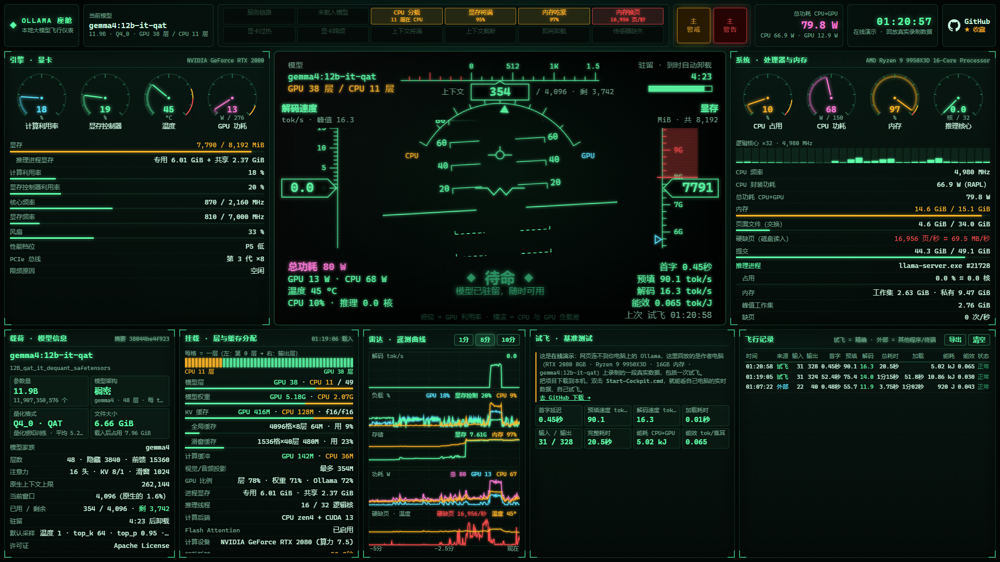

# Ollama HUD · Ollama 座舱

战斗机 HUD 风格的本地大模型实时监控面板，全中文界面。实时看清 Ollama 里的模型跑得怎么样：解码速度、首字延迟、显存/内存、GPU/CPU 分层、KV 缓存、功耗与能效、上下文占用……一屏看完。

*A fighter-jet HUD style, real-time dashboard for local LLMs running in [Ollama](https://ollama.com) (Chinese UI). [English summary below](#english).*

**[▶ 在线演示 Live demo](https://felixjiashengfu.github.io/ollama-hud/)** · [🤗 Hugging Face Space](https://huggingface.co/spaces/felixfufu723/ollama-hud) · 觉得有用就点右上角 ⭐ Star 收藏一下



> 在线演示回放的是在作者电脑（RTX 2080 8GB · Ryzen 9 9950X3D · 16GB 内存 · `gemma4:12b-it-qat`）上录制的一段真实数据。下载到本机运行，看到的就是你自己电脑的实时数据。

## 能看到什么

- **HUD 主仪表**：解码速度（速度带）、显存占用（高度带）、上下文已用/剩余（航向带）；俯仰 = GPU 利用率，横滚 = CPU 与 GPU 负载差；当前阶段（加载中 / 预填充 / 解码 / 待命 / 停机）。
- **引擎 · 显卡**：计算利用率、显存控制器利用率、温度、功耗、显存、核心/显存频率、风扇、性能档位、PCIe 总线、限频原因、推理进程实际占用的专用/共享显存。
- **系统 · 处理器与内存**：CPU 总占用与每个逻辑核、CPU 频率、**CPU 封装功耗（RAPL）**、**CPU+GPU 总功耗**、内存、页面文件（交换）、硬缺页、推理进程的 CPU/内存/缺页/线程/磁盘读写。
- **载荷 · 模型信息**：参数量、架构（稠密 / 混合专家）、量化格式与平均位宽、文件大小、层数与注意力结构、原生上下文上限、当前窗口、默认采样、许可证、能力（视觉/音频/工具/思考）。
- **挂载 · 层与缓存分配**：每一层在 GPU 还是 CPU、权重和 KV 缓存在 GPU/CPU 各占多少、KV 精度、计算缓冲、推理线程、计算后端、Flash Attention、加载耗时。
- **雷达 · 遥测曲线**：解码速度、负载、显存/内存、功耗、硬缺页与温度的 1/5/10 分钟曲线。
- **试飞 · 基准测试**：一键发测试请求，得到首字延迟、预填速度、解码速度、加载耗时、输入/输出 token、完整耗时、**能耗（焦耳）与能效（token/焦耳）**；支持冷启动测加载时间。
- **飞行记录**：不只记录试飞——终端里的 `ollama run`、其他程序调用 Ollama 的每一次请求也会被记下（数值来自推理进程日志，精确），包括是否超出上下文被截断。可导出 CSV。
- **告警灯**：CPU 分载、显存将满、内存吃紧、内存换页、显卡过热、显卡降频、上下文将满、上下文截断、即将卸载……有问题时“主警戒/主警告”闪烁。
- **手机查看**：同一 Wi-Fi 下扫码就能在手机上看（带访问码）。

## 快速开始

需要：Windows 10/11 · [Ollama](https://ollama.com) · [Deno](https://deno.com) 2.x（`winget install DenoLand.Deno`）· NVIDIA 显卡（没有的话显卡面板为空，其余照常）。

```bash
git clone https://github.com/FelixJiashengFu/ollama-hud.git
```

然后双击 `Start-Cockpit.cmd`，浏览器会打开 <http://127.0.0.1:8765/>。用 `ollama run 模型名` 聊天，或在面板里点「试飞」，仪表就动起来了。关掉黑色窗口即停止。

不用装任何依赖：服务端是单个 Deno 脚本，网页是单个 HTML 文件。

## 用手机看

1. 手机和电脑连**同一个 Wi-Fi**。
2. 在电脑的仪表盘右上角点「手机」，用手机相机或浏览器扫二维码。
3. 第一次启动时 Windows 防火墙可能会问 Deno 能否访问网络：勾选「专用网络」，点「允许访问」。

二维码里带有访问码（保存在本地的 `.cockpit-key`，不会上传），没有访问码的设备打不开仪表盘，也用不了试飞。删掉 `.cockpit-key` 再重启即可作废旧访问码。只想本机访问时，去掉 `Start-Cockpit.cmd` 里的 `--lan`。

## 数据从哪来

| 来源 | 内容 | 频率 |
| --- | --- | --- |
| Ollama `/api/ps` `/api/show` `/api/tags` | 已载入模型、显存占比、驻留倒计时、参数量、架构、量化、文件大小、原生上下文上限、许可证 | 1 秒 |
| 推理进程 `llama-server` 的 `/slots` | **任何客户端**的实时解码速度、上下文占用、预填/解码阶段、上下文平移 | 0.2 秒 |
| Ollama 日志 `%LOCALAPPDATA%\Ollama\server.log` | GPU/CPU 层数、权重与 KV 缓存的分配和精度、线程、计算后端、Flash Attention、加载耗时；每个请求的精确预填/解码耗时、缓存复用、是否截断 | 0.5 秒 |
| `nvidia-smi` | GPU 利用率、显存控制器利用率、显存、温度、功耗、频率、风扇、性能档位、PCIe、限频原因 | 0.5 秒 |
| `sampler.ps1`（Windows 性能计数器） | CPU 占用/频率、**RAPL 封装功耗（免管理员）**、内存/提交/页面文件、硬缺页、Ollama 各进程的 CPU/内存/缺页/线程/磁盘、进程级显存 | 1 秒 |

能耗是积分值：GPU 功耗按时间做梯形积分，CPU 用 RAPL 累计能量计数器，不是“瞬时功率 × 时间”。总功耗 = CPU 封装 + 显卡板卡，不含主板、内存、硬盘、风扇和电源损耗。

## 隐私

一切都在你自己的电脑上运行，不上传任何遥测数据。网页只会联网做两件事：读取本仓库的 Star 数（GitHub API），以及在你点「手机」时从 cdnjs 加载二维码组件。

## 文件

| 文件 | 作用 |
| --- | --- |
| `server.ts` | Deno 服务：汇总各路数据，通过 SSE 推给网页；代理试飞请求；局域网访问码 |
| `sampler.ps1` | Windows 性能计数器采样（CPU、功耗、内存、进程） |
| `index.html` | 整个仪表盘（单文件，无依赖）；连不上本地服务时自动进入演示模式 |
| `demo/demo.json` | 在线演示回放的录制数据（路径已脱敏） |
| `Start-Cockpit.cmd` | 一键启动 |

可用环境变量：`COCKPIT_PORT`（默认 8765，被占用时自动顺延）、`OLLAMA_HOST`、`OLLAMA_LOG`、`COCKPIT_LAN=1`（等同 `--lan`）。

## English

**Ollama HUD** is a fighter-jet style heads-up display for local LLMs served by Ollama on Windows. It shows, in real time: decode speed, time-to-first-token, prefill speed, VRAM/RAM, GPU vs CPU layer offload, KV-cache size and placement, CPU package power (RAPL) and GPU power, energy per request (J) and efficiency (tokens/J), context usage and truncation, page-file swapping, and more. It also tracks requests made by *other* clients (e.g. `ollama run` in a terminal) by reading the llama-server runner's `/slots` endpoint and Ollama's log.

- **Run it:** install Deno and Ollama, clone this repo, double-click `Start-Cockpit.cmd`, open <http://127.0.0.1:8765/>.
- **Phone:** same Wi-Fi, click 「手机」 in the top bar and scan the QR code (an access key protects the LAN endpoint).
- **No dependencies:** one Deno script, one PowerShell sampler, one HTML file.
- **Demo:** <https://felixjiashengfu.github.io/ollama-hud/> (also on [Hugging Face Spaces](https://huggingface.co/spaces/felixfufu723/ollama-hud)) replays real recorded telemetry.

The UI is in Chinese. Requirements: Windows 10/11, Ollama (llama.cpp runner), Deno 2.x, an NVIDIA GPU for the GPU panel.

## 许可证 License

[MIT](LICENSE) © 2026 Jiasheng Fu
